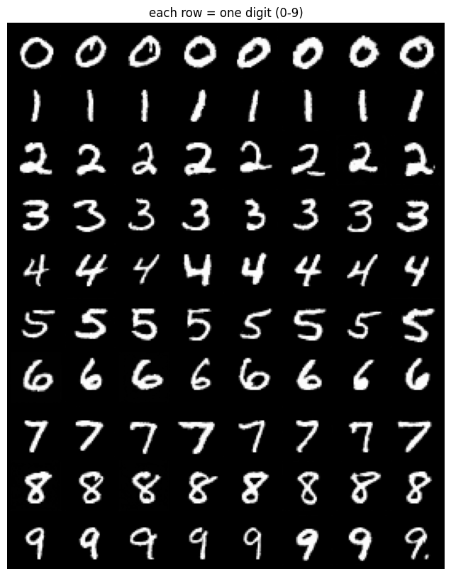
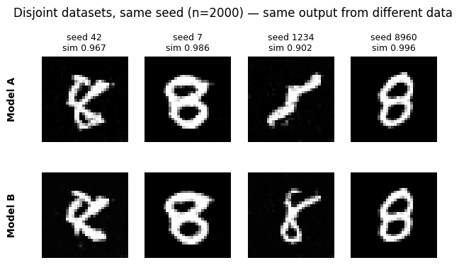

# MNIST diffusion: training, generation, and memorization

Conditional diffusion models trained on MNIST, with a second experiment comparing memorization and cross-model agreement as the training set grows.

**Valentyn Skalenchuk · Physics seminar, University of Leipzig, 2026**

## Notebooks

| Notebook | What it does |
| --- | --- |
| [01 · Conditional DDPM](notebooks/01_conditional_ddpm_mnist.ipynb) | Trains a residual U-Net with time and class embeddings, EMA checkpoints, and classifier-free guidance; generates requested digits. |
| [02 · Memorization and generation](notebooks/02_memorization_and_generation.ipynb) | Trains A/B models on disjoint subsets of digit 8; compares matched-seed DDIM outputs and their nearest training images; shows latent interpolation. |

The code was developed with AI assistance during a collaborative seminar. This repository curates my training and quantitative memorization experiments. It contains cleaned notebook code and selected historical outputs; checkpoints, classmates' reports, and the seminar PDF are not included.

## Run

Use a GPU runtime in Google Colab, or Python 3.10+ with Jupyter:

```bash
python -m pip install -r requirements.txt
jupyter lab
```

Open either notebook and run cells in order. MNIST downloads automatically. PyTorch and torchvision must be a compatible pair; install the appropriate GPU build for your environment if needed. Dependencies are version ranges, not a locked reproduction environment.

Notebook 01 trains for eight minutes by default. Increase `MAX_MINUTES` for a longer run. It saves weights, EMA, and optimizer state and resumes if its checkpoint exists. In Colab, set `DDPM_CKPT_DIR` to mounted persistent storage before starting; the default local directory disappears when the runtime resets. Sampling uses 1000 reverse steps and can take several minutes.

Notebook 02 defaults to `QUICK_TEST=True`: n=10 and n=50, 600 updates per model. This checks the workflow and is too short for the historical results below. Set `QUICK_TEST=False` for n={10,25,50,100,250,500,1000,2000} and 6000 updates per model. The full sweep needs hours of GPU time across resumable sessions; its budget guard may leave jobs for a later session. In Colab it mounts Drive and uses separate smoke/full directories. Elsewhere, `MEMGEN_CKPT_DIR` selects the checkpoint root. Rerun the notebook to continue unfinished jobs.

Training resumption restores model/optimizer state but does not restore the exact random stream or minibatch position. Hardware and library versions can also change results. The two notebooks use different samplers: stochastic DDPM in 01, deterministic 50-step DDIM in 02.

## Selected results from the original runs

These images and numbers were extracted from saved outputs of the original notebooks. They were not produced by a fresh run of the cleaned notebooks. The original environment and checkpoints are not bundled, so exact numerical reproduction is not established.

### Class-conditioned generation

Each row requests a digit from 0 through 9. These samples come from an earlier, longer training session, not the default eight-minute demonstration.



### Memorization and cross-model agreement

A and B train on disjoint subsets of digit 8. Both receive the same initial Gaussian noise for each evaluation seed.

- **M:** average nearest-training-image cosine similarity, averaged over both models.
- **C:** average cosine similarity between the two models' matched-seed outputs.

| Images per model n | Nearest-train M | Cross-model C |
| ---: | ---: | ---: |
| 10 | 0.9974 | 0.7793 |
| 100 | 0.9950 | 0.8852 |
| 500 | 0.9521 | 0.9496 |
| 2000 | 0.9231 | 0.9677 |

Small-data outputs are very close to training images. At larger n, A/B outputs agree more closely while nearest-training similarity decreases. This is evidence of a finite-data crossover in these diagnostics. The crossing of the curves is not a measured thermodynamic critical point.

The [complete endpoint table](results/historical_endpoint_metrics.csv) contains eight dataset sizes and population standard deviations across five sampling seeds (`ddof=0`). Those error bars do not measure uncertainty across repeated training runs. [Provenance](results/provenance.json) records the original notebook hashes and output locations.



The historical image retains its original “same output” title. It shows similar endpoints, with the actual cosine similarities printed above the samples; the outputs are not identical.

## What these measurements establish

Cosine similarity in normalized pixel space is a simple diagnostic affected by the common image background. Taking a maximum over a larger training bank can also change M. Cross-model agreement depends on the chosen noise coupling, model initialization, and training randomness; it is not a held-out likelihood or proof of distribution learning. The original runs are not a replicated ensemble over training seeds.

The cleaned notebooks retain nearest-image inspection and latent interpolation as visual checks. They omit the original repeated plot revisions, rescue/archive cells, automated downloads, speculative susceptibility interpretations, and timescale-scaling claims. No energy landscape, critical exponent, or proof of non-copying is claimed.

## Validation status

The curated notebook files pass notebook-format and Python syntax checks. GPU training and sampling have not been rerun for this release; the saved historical outputs provide evidence of the original experiments, not end-to-end validation of the cleaned code.
